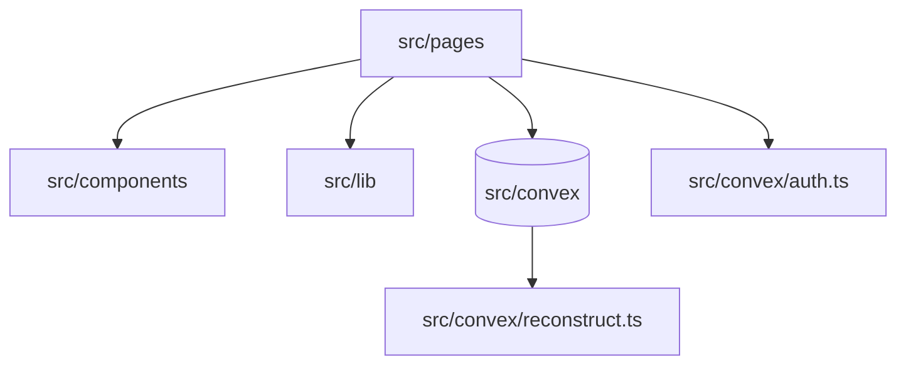

# model-capture

A full-stack web application to capture, import, and view 3D models for creatives and professionals.


<!-- SCREENSHOT PLACEHOLDER: hero image of 3d model viewer -->
_Screenshot coming soon._

## Features

- Scan 3D models from photos via the Tripo API (if configured), or use a demo model.
- Import and export existing 3D models in formats like GLB, GLTF, OBJ, STL, and PLY.
- View and manage your 3D models in a personal library.
- Inspect and process 3D models in the studio using Three.js.
- Secure authentication via Convex Auth supporting OTP and anonymous sessions.

## Architecture



The frontend uses React and Vite, routing through `src/pages` for different views like the library, capture, and studio. UI elements and Three.js components are housed in `src/components`, while `src/lib` contains exporters (`model-io.ts`) and processing logic (`mesh-edit.ts`). All state, database operations, and authentication are handled by the Convex backend defined in `src/convex`, with 3D reconstruction actions in `src/convex/reconstruct.ts`.

## Quick start

**Prerequisites:** Bun must be installed.

```bash
bun install
# In one terminal, start the Convex backend:
npx convex dev
# In another terminal, start the frontend:
bun run dev

bun run test
```

## Configuration

**Frontend variables** (`.env`):

| Environment Variable | Purpose | Default |
| --- | --- | --- |
| `VITE_CONVEX_URL` | Convex deployment URL for the frontend | (Required) |
| `VITE_VLY_APP_ID` | Vly application identifier for monitoring | (Optional) |
| `VITE_VLY_MONITORING_URL` | Vly monitoring endpoint URL | (Optional) |

**Backend variables** (set via `npx convex env set`):

| Environment Variable | Purpose | Default |
| --- | --- | --- |
| `CONVEX_DEPLOYMENT` | Deployment used by Convex CLI | (Required) |
| `CONVEX_SITE_URL` | Convex site URL for auth | (Set by Convex) |
| `TRIPO_API_KEY` | Key for photo-to-3D reconstruction API | (Optional) |
| `VLY_INTEGRATION_KEY` | Key for Vly platform integrations | (Optional) |
| `JWKS` | Convex auth keys (from deployment env) | (Set by Convex) |
| `JWT_PRIVATE_KEY` | Convex auth keys (from deployment env) | (Set by Convex) |
| `SITE_URL` | Convex auth site URL (from deployment env) | (Set by Convex) |

## Screenshots

<!-- SCREENSHOT PLACEHOLDER: library view -->
_Screenshot coming soon._

## Roadmap

- See issues.

## License & credits

No license file yet (all rights reserved).

See [docs/development-guide.md](docs/development-guide.md) for the original development instructions.
