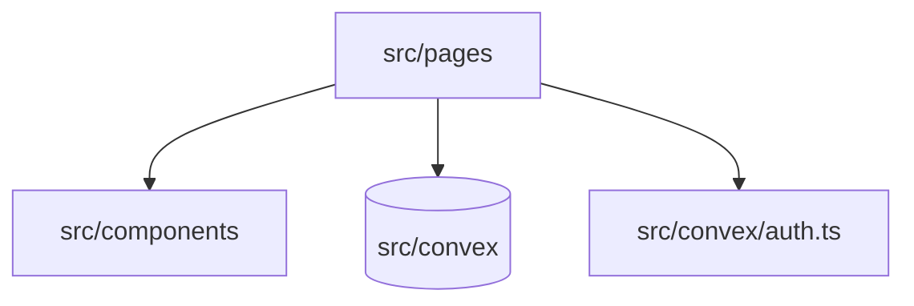

# model-capture

A full-stack web application to capture, import, and view 3D models for creatives and professionals.


<!-- SCREENSHOT PLACEHOLDER: hero image of 3d model viewer -->
_Screenshot coming soon._

## Features

- Scan 3D models from photos using the capture flow.
- Import existing 3D models in formats like GLB, GLTF, OBJ, STL, and PLY.
- View and manage your 3D models in a personal library.
- Inspect and process 3D models in the studio using Three.js.
- Secure authentication via Convex Auth supporting OTP and anonymous sessions.

## Architecture



The frontend uses React and Vite, routing through `src/pages` for different views like the library, capture, and studio. UI elements and Three.js components are housed in `src/components`. All state, database operations, and authentication are handled by the Convex backend defined in `src/convex`.

## Quick start

**Prerequisites:** Bun must be installed.

```bash
bun install
bun run dev
bun run test
```

## Configuration

| Environment Variable | Purpose | Default |
| --- | --- | --- |
| `VITE_CONVEX_URL` | Convex deployment URL for the frontend | (Required) |
| `CONVEX_DEPLOYMENT` | Deployment used by Convex CLI | (Required) |
| `CONVEX_SITE_URL` | Convex site URL for auth | `http://localhost:5173` |

## Screenshots

<!-- SCREENSHOT PLACEHOLDER: library view -->
_Screenshot coming soon._

## Roadmap

- See issues.

## License & credits

Unlicensed.

See [docs/development-guide.md](docs/development-guide.md) for the original development instructions.
